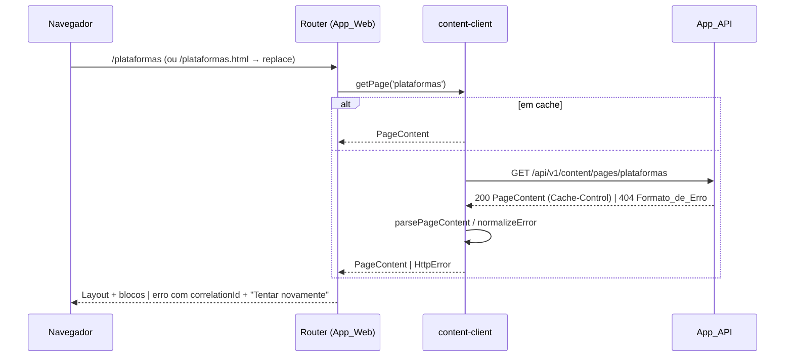

# Design Document — legacy-migration

**Estimativa_de_Esforco:** 44h (Spec_Simples) · **Requisitos:** [requirements.md](./requirements.md) · **Padrões:** [project-standards](../project-standards/design.md)

## Overview

A migração troca as quatro páginas estáticas por um App_Web React que lê o conteúdo do App_API. A aparência fica a mesma, e o Site_Legado só é removido no fim, depois que a Baseline_Visual e o teste de texto provarem a equivalência.

Princípios:

1. **Conteúdo é dado, não marcação.** O Conteudo_de_Pagina é JSON estruturado em blocos tipados e texto rico sem HTML (Req. 3.5, 4.5). O React renderiza cada bloco com um componente próprio.
2. **Um contrato, dois lados.** O JSON Schema `page-content.schema.json` em `packages/contracts` gera os tipos TS. O App_API valida os arquivos de dados contra ele na inicialização, e o App_Web valida a resposta antes de renderizar.
3. **Legado como oráculo até o fim.** Enquanto o Site_Legado existir, ele é a referência: capturas de tela (Baseline_Visual) e extração de texto. Os testes visuais continuam depois da remoção, comparando com as capturas versionadas.
4. **Remoção em uma única tarefa.** Todas as referências ao Site_Legado (arquivos, `legacyPaths`, Constituição, steering, documentação) saem juntas, com ADR.

## Architecture

```
apps/api/src/content/
├── content.module.ts
├── content.controller.ts        # GET /api/v1/content/pages, /pages/:slug (@Public)
├── content.service.ts           # carrega e indexa os dados validados
├── content-loader.ts            # lê data/*.json e valida com ajv (falha → encerra a inicialização)
└── data/{inicio,primeiros-passos,plataformas,playbook}.json

packages/contracts/
├── schemas/page-content.schema.json
├── src/generated/page-content.ts    # json-schema-to-typescript
└── src/page-content.ts              # isPageContent, parsePageContent, ICON_NAMES

apps/web/src/
├── app/App.tsx, app/routes.tsx       # BrowserRouter, rotas, redirecionamentos, 404
├── app/route-table.ts                # resolveRoute(path) puro
├── components/layout/{Layout,Header,Footer,SkipLink}.tsx
├── components/icons/Icon.tsx         # nome → componente lucide-react
├── components/content/{RichText,PageHero,TopicSection,Subtopic,BulletList,StepList,
│                       CardGrid,LinkList,ActionRow,CadenceGrid,ScriptBox,ChecklistPanel}.tsx
├── features/pages/ContentPage.tsx    # busca o slug e renderiza blocos; loading/erro
├── features/pages/NotFoundPage.tsx
├── features/checklist/{useChecklist.ts, checklist-storage.ts}
├── api/content-client.ts             # getPage(slug), cache em memória
└── theme/{tokens.ts, global.css, fonts.ts}
apps/web/e2e/                         # Playwright: visual, ponta a ponta, baseline
```

### Fluxo de uma página



## Components and Interfaces

### 1. Contrato_de_Conteudo

Modelo, expresso em TS (o schema JSON é a fonte; os tipos são gerados):

```ts
type IconName = 'arrow-right' | 'award' | 'book-open' | 'chevron-right' | 'circle-check' | 'clock'
  | 'compass' | 'external-link' | 'house' | 'layers' | 'receipt' | 'sparkles';

/** Trecho de texto rico. Nunca é interpretado como HTML. */
interface Span { text: string; strong?: boolean; emphasis?: boolean; href?: string /* ^https:// */ }
type RichText = Span[];

interface PageContent {
  slug: 'inicio' | 'primeiros-passos' | 'plataformas' | 'playbook';
  documentTitle: string;              // <title> do Site_Legado
  navLabel: string;
  hero: { badge?: { icon?: IconName; text: string }; eyebrow?: string; title: RichText[] /* linhas */;
          description: RichText; actions?: Action[]; variant: 'home' | 'page' };
  blocks: Block[];
}
interface Action { label: string; to?: Route; href?: string; icon?: IconName; style: 'primary' | 'secondary' }

type Block =
  | { type: 'cards'; cards: { icon: IconName; accent: 'blue' | 'purple' | 'teal'; tag: string; title: string;
                              subtitle: string; description: RichText; action: Action }[] }
  | { type: 'checklist'; label: string; title: string; meta: { icon: IconName; text: string };
      items: { id: string; day: string; title: string; description: string; defaultDone: boolean }[] }
  | { type: 'topic'; number: string; title: string; subtopics: Subtopic[] };

interface Subtopic { title: string; content: SubtopicItem[] }
type SubtopicItem =
  | { type: 'paragraph'; text: RichText }
  | { type: 'bullets'; items: RichText[] }
  | { type: 'steps'; items: RichText[] }                         // badge numerado 1..n
  | { type: 'links'; items: { title: string; description: string; href?: string }[] }  // sem href = is-disabled
  | { type: 'cadence'; items: { day: string; action: string; detail: string }[] }
  | { type: 'script'; text: string }
  | { type: 'actions'; items: Action[] };
```

O schema usa `additionalProperties: false`, `minLength: 1` nos textos, `enum` nos ícones, nos slugs e nos acentos, e `pattern: "^https://"` em `href`. Os ids do checklist seguem `^[a-z][a-z0-9-]*$` e são únicos (verificado em código, porque o JSON Schema não expressa unicidade por campo). Um ícone fora do `enum` reprova o contrato (Req. 6.4), e o componente `Icon` ignora nomes desconhecidos em tempo de execução.

`packages/contracts/src/page-content.ts` exporta `ICON_NAMES`, `isPageContent(value)` (guarda de tipo escrita à mão, sem dependência de runtime, no mesmo padrão de `isErrorFormat`), `parsePageContent(json)` e `serializePageContent(page)`. Um teste de propriedade confirma que `isPageContent` concorda com o ajv sobre o schema.

O OpenAPI do App_API referencia o schema por `@ApiExtraModels`/`@ApiOkResponse({ schema })`, com o JSON Schema convertido para os componentes OpenAPI (`$defs` → `components.schemas`), para que `openapi-typescript` também tipe os caminhos `/api/v1/content/**` em `paths`.

### 2. App_API: módulo de conteúdo

- **`content-loader.ts`:** `loadPages(dir): PageContent[]` lê `data/*.json`, valida cada arquivo com ajv compilado a partir do schema canônico e confere a unicidade dos slugs e dos ids do checklist. Em erro, lança `ContentValidationError` com `{arquivo}: {instancePath} {mensagem}`, e o `main.ts` encerra com `process.exit(1)` antes do `listen` (Req. 3.3). Os arquivos JSON são copiados para `dist` pelo `nest-cli.json` (`assets`).
- **`content.service.ts`:** índice em memória por slug; `list()` retorna `{ slug, navLabel, documentTitle }[]` na ordem de navegação.
- **`content.controller.ts`:** rotas `@Public()` com `GET pages` e `GET pages/:slug`. O slug é validado por `ParseEnumPipe` ou por pipe próprio; slug desconhecido gera `NotFoundException`, e o `ErrorFormatFilter` responde 404 `NOT_FOUND` (Req. 3.4). O interceptor `CacheControlInterceptor` aplica `Cache-Control: public, max-age=${CONTENT_CACHE_MAX_AGE_SECONDS}` (padrão 300, validado com zod, inteiro de 0 a 86400; Req. 3.8).
- **CORS:** `app.enableCors({ origin: env.API_CORS_ORIGIN })`, já previsto na env.
- **Dados:** os quatro JSON transcrevem integralmente o Site_Legado. O `slug` da página inicial é `inicio`, servido na rota `/`.

### 3. App_Web

**Roteamento (`react-router` em modo declarativo):**

| Caminho | Resultado |
|---------|-----------|
| `/` | `ContentPage slug=inicio` |
| `/primeiros-passos`, `/plataformas`, `/playbook` | `ContentPage` com o slug homônimo |
| `/index.html`, `/{slug}.html` | `<Navigate replace>` para a Rota_Canonica (Req. 1.2) |
| demais | `NotFoundPage` (Req. 1.3) |

`resolveRoute(path)` é uma função pura em `route-table.ts`, que retorna `{ kind: 'page', slug } | { kind: 'redirect', to } | { kind: 'not-found' }`. As rotas do router são derivadas dela, sem tabela duplicada. Barras finais e maiúsculas são normalizadas (`/Playbook/` → `/playbook`).

**Título e foco:** `ContentPage` renderiza `<title>{documentTitle}</title>`, que o React 19 eleva para o `<head>`. Na troca de rota, um efeito move o foco para o `h1` (`tabIndex={-1}`) (Req. 1.4, 1.5).

**Navegação:** os itens do Layout_Comum são fixos no App_Web, com rótulos e ícones do Site_Legado, porque a navegação precisa existir mesmo quando a API falha. O verificador do App_Web confere que os `navLabel` do conteúdo coincidem com esses rótulos (teste de contrato). `NavLink` aplica `aria-current="page"` e a classe ativa (Req. 2.2).

**content-client:** `getPage(slug, { signal })` usa o `http-client` existente (`openapi-fetch` + `normalizeError`), valida o corpo com `parsePageContent` (falha → `UNEXPECTED_ERROR` com o status) e guarda o resultado num `Map` em memória por sessão (Req. 4.4). Requisições concorrentes ao mesmo slug compartilham a mesma promise. O hook `usePage(slug)` expõe `{ status: 'loading' | 'ready' | 'error', page?, error?, retry }`.

**Renderização:** `RichText` mapeia cada `Span` para texto, `<strong>`, `<em>` ou `<a target="_blank" rel="noopener noreferrer">`. O link recebe o sufixo visualmente oculto "(abre em nova aba)" e o ícone `external-link` (Req. 4.6). O código não usa `dangerouslySetInnerHTML` (Req. 4.5); a regra `react/no-danger` não está disponível, então um teste estático confere a ausência no código de `apps/web/src`.

**Estados:** em carregamento, `<main aria-busy="true">` com um esqueleto e o texto oculto "Carregando conteúdo…". Em erro, um bloco `role="alert"` com a mensagem pt-BR, `Código de correlação: {correlationId}` e o botão "Tentar novamente", que limpa o cache do slug e repete a busca (Req. 4.2, 4.3).

**Checklist (`features/checklist`):**

```ts
type ChecklistState = Record<string, boolean>;
function readChecklist(storage: Storage | null): ChecklistState;   // JSON inválido ou indisponível → {}
function writeChecklist(storage: Storage | null, state: ChecklistState): boolean;  // false se falhar
function effectiveState(items: { id: string; defaultDone: boolean }[], stored: ChecklistState): Record<string, boolean>;
function useChecklist(items): { done: Record<string, boolean>; toggle(id: string): void };
```

Formato idêntico ao `js/main.js`: `JSON.stringify({ setup: true, plataformas: false })` na chave `nuagehub-checklist`. O estado efetivo é o valor gravado quando existe e `defaultDone` quando não (Req. 5.3, 5.4). Uma exceção de `localStorage` (acesso ou `setItem`) é engolida, e o estado continua só em memória (Req. 5.5). Valores não booleanos gravados são ignorados por item. Cada item é `<div role="checkbox" aria-checked tabIndex={0}>` com Enter e Espaço (Req. 5.2, 5.6), mantendo a marcação do legado para a Paridade_Visual.

**Ícones e fonte (Req. 6):** `lucide-react` (versão exata) com um mapa `IconName → componente`, todos `aria-hidden` e com `size`/`strokeWidth` iguais aos do legado. `@fontsource/inter` com os pesos 400, 500, 600, 700 e 800, importados em `theme/fonts.ts`. O `index.html` do App_Web não tem `preconnect` nem links externos. Um teste sobre `dist/` (após `vite build`) falha se algum arquivo citar `fonts.googleapis.com`, `fonts.gstatic.com` ou `unpkg.com` (Req. 6.3).

**Estilos (Req. 7):**

- `theme/global.css`: reset, `body`, `.container`, `bg-glow` e utilitários globais do `css/styles.css`, com as variáveis CSS geradas de `tokens.ts` por `applyTokens()` no `:root` na inicialização. Não há valores literais de cor.
- Um `*.module.css` por componente, portado do bloco correspondente do `css/styles.css`, com as mesmas media queries (640 px, 768 px). As cores vêm só de `var(--…)` dos tokens. Um teste estático varre os `*.module.css` e falha se encontrar literais `#hex`, `rgb(` ou `hsl(` (Req. 7.1).
- Os estados de foco (`:focus-visible`), hover e `.done` do checklist são portados literalmente (Req. 7.5).

**Acessibilidade (Req. 8):** `SkipLink` é o primeiro filho do `body` e aponta para `#conteudo` (o `main`). Hierarquia: `h1` no hero, `h2` nos títulos de tópico e no checklist, `h3` nos subtópicos, cartões e itens do checklist. O legado usa `h3`/`h4` sem `h2`; aqui a hierarquia é corrigida sem mudança visual, porque os estilos ficam por classe e não por tag. Isso é um desvio consciente da marcação do legado, coberto pelo Req. 8.2.

### 4. Testes visuais, de texto e de ponta a ponta

Ferramenta: `@playwright/test` (versão exata) com Chromium, em `apps/web/e2e/`, com config `apps/web/playwright.config.ts`. Os testes de ponta a ponta ficam fora de `src/`, porque não pertencem a um módulo específico; isso é compatível com o Req. 14.6 de project-standards, que trata de testes de unidade. Os arquivos seguem `*.e2e.test.ts` e são excluídos do Vitest.

`webServer` do Playwright:

1. App_API: `pnpm --filter @nuagehub/api build && node apps/api/dist/main.js`, com env de teste.
2. App_Web: `vite preview` do build, com `VITE_API_BASE_URL` apontando para a API.
3. Somente no projeto `legacy-baseline`: servidor estático da raiz (`node e2e/serve-legacy.mjs`, que usa `node:http` sem dependência nova) para o Site_Legado.

Projetos do Playwright:

| Projeto | Quando | O que faz |
|---------|--------|-----------|
| `legacy-baseline` | manual: `pnpm --filter @nuagehub/web e2e:baseline`, antes da remoção | Fotografa as quatro páginas legadas em 375, 768 e 1280 px, depois de `document.fonts.ready` e com o checklist no estado inicial, e grava em `e2e/__screenshots__/`. |
| `visual` | CI e local | Fotografa as Paginas_Migradas nas mesmas larguras e compara com `toHaveScreenshot` (`maxDiffPixelRatio: 0.02`, animações desativadas) (Req. 7.3, 7.4). |
| `e2e` | CI e local | Percorre as Rotas_Canonicas, as URLs_Legadas (`page.url()` final e histórico), a 404, o checklist (marca, recarrega, confere o `localStorage` e a semente legada `{"plataformas":true}`), a navegação por teclado e o axe-core em cada página (Req. 1, 2, 5, 8, 10.3). |

**Teste de texto (Req. 10.2):** `apps/api/src/content/legacy-parity.test.ts` extrai o texto visível de cada HTML legado (remove `head`, `script`, tags e entidades; normaliza espaços) e verifica que cada frase do legado aparece no texto concatenado do Conteudo_de_Pagina correspondente, e vice-versa para títulos e itens. O teste é apagado na tarefa de remoção.

**CI (Req. 10.4):** o novo job `e2e` no `ci.yml` roda quando `apps/web/**`, `apps/api/**` ou `packages/contracts/**` mudam. Ele instala o Chromium com `pnpm --filter @nuagehub/web exec playwright install --with-deps chromium` e executa os projetos `visual` e `e2e`. As capturas são geradas em macOS localmente e o CI roda em Linux. Para evitar falso positivo de renderização de fonte, o job usa a imagem oficial `mcr.microsoft.com/playwright:v{versão}-noble`, e a baseline é gerada na mesma imagem via `docker run` documentado no README do App_Web. Se o Docker não estiver disponível localmente, a baseline gerada no macOS fica válida só para execução local, e o job de CI a regenera numa primeira execução com `--update-snapshots`, publicada como artefato para revisão. Essa escolha é registrada no ADR-0005.

### 5. Remoção do Site_Legado

Tarefa única, executada só após aprovação do usuário (Req. 9.1):

- `git rm` de `index.html`, `primeiros-passos.html`, `plataformas.html`, `playbook.html`, `css/` e `js/`.
- `standards.config.json`: `"legacyPaths": []`. A seção "Site_Legado" sai de `.prettierignore`, `eslint.config.mjs` passa a ter `const legacyPaths = []`, e os `exclude` do `lefthook.yml` saem. `legacyListsCheck` passa a aceitar comandos sem `exclude` quando a lista canônica estiver vazia (Req. 9.2).
- `legacy-baseline.json` e o teste de hash saem e dão lugar a um teste de ausência dos arquivos na raiz (Req. 9.3). `legacy-parity.test.ts` e o projeto `legacy-baseline` também saem. `tokens.test.ts` deixa de ler `css/styles.css` e passa a fixar os valores (snapshot) de `tokens.ts` (Req. 9.6).
- Constituição: a regra "Trate o Site_Legado como conteúdo intocável…" e o item "Preserve os caminhos do Site_Legado…" saem. Steering `repository-structure.md` e `code-style.md` perdem as menções, `README.md` troca a seção do Site_Legado por "Executar o portal", e `docs/legacy-migration-backlog.md` é marcado como concluído e arquivado. As datas dos cabeçalhos são atualizadas (Req. 9.4).
- `docs/adr/0005-conclusao-da-migracao-do-legado.md` (Req. 9.5).

## Data Models

Os modelos `PageContent`, `Block`, `Span` e `ChecklistState` estão na seção anterior. Variáveis novas do App_API (`.env.example` do app e da raiz): `CONTENT_CACHE_MAX_AGE_SECONDS=300`. Do App_Web: `VITE_API_BASE_URL` (já existente).

## Correctness Properties

### Property 1: Round-trip do Conteudo_de_Pagina

*Para qualquer* `PageContent` válido gerado a partir do schema, `parsePageContent(serializePageContent(p))` é profundamente igual a `p`.

**Validates: Requirements 3.7**

### Property 2: Guarda de tipo equivalente ao schema

*Para qualquer* valor JSON (válido gerado ou mutação arbitrária de um válido), `isPageContent(v)` é verdadeiro se e somente se o ajv, com `page-content.schema.json`, aceitar `v`.

**Validates: Requirements 3.6, 6.4**

### Property 3: Resolução de rotas

*Para qualquer* caminho, `resolveRoute` devolve `page` com o slug correto para as Rotas_Canonicas (com variações de barra final e maiúsculas), `redirect` para a Rota_Canonica correspondente a cada URL_Legada e `not-found` para todo o resto. Nunca devolve `redirect` para um destino que não seja Rota_Canonica.

**Validates: Requirements 1.1, 1.2, 1.3**

### Property 4: Checklist persistido igual ao exibido

*Para qualquer* conjunto de itens e *qualquer* sequência de ativações, sobre um `Storage` em memória, o estado gravado na Chave_do_Checklist é igual ao estado exibido. Uma nova montagem lendo o mesmo `Storage` reproduz o mesmo estado efetivo.

**Validates: Requirements 5.2, 5.3, 5.7**

### Property 5: Leitura tolerante do checklist

*Para qualquer* string gravada na Chave_do_Checklist (inclusive JSON inválido, arrays, números e objetos com valores não booleanos) e para um `Storage` que lança exceção, `effectiveState` retorna um booleano para cada item: o valor booleano gravado quando existir e `defaultDone` caso contrário. Nenhuma exceção escapa.

**Validates: Requirements 5.4, 5.5**

### Property 6: Texto rico nunca vira HTML

*Para qualquer* `RichText` cujos textos contenham marcação arbitrária (`<script>`, ``, entidades), o DOM renderizado por `RichText` tem `textContent` igual à concatenação dos textos e contém só elementos `strong`, `em`, `a`, `span` e `svg`.

**Validates: Requirements 4.5**

### Property 7: Slug desconhecido vira 404 no Formato_de_Erro

*Para qualquer* string de slug fora do conjunto de slugs conhecidos, `GET /api/v1/content/pages/{slug}` responde 404 com corpo válido no Formato_de_Erro e código `NOT_FOUND`. Para cada slug conhecido, responde 200 com corpo aceito por `isPageContent` e com `Cache-Control`.

**Validates: Requirements 3.1, 3.4, 3.8**

## Error Handling

| Situação | Comportamento |
|----------|---------------|
| Arquivo de conteúdo inválido na inicialização da API | `process.exit(1)` com `{arquivo}: {campo} {mensagem}` (Req. 3.3) |
| Slug inexistente | 404 `NOT_FOUND` no Formato_de_Erro |
| API indisponível, timeout ou 5xx | `normalizeError`; página de erro com `correlationId` e "Tentar novamente" |
| Corpo 200 fora do Contrato_de_Conteudo | `UNEXPECTED_ERROR` com o status recebido; não renderiza conteúdo parcial |
| `localStorage` indisponível ou JSON inválido | estado inicial em memória; sem aviso ao usuário (comportamento do legado) |
| Ícone desconhecido em tempo de execução | ícone omitido; o contrato já o rejeita em teste |
| Rota desconhecida | `NotFoundPage` com link para Início |

## Testing Strategy

- **Propriedades (fast-check, 100 execuções):** P1 e P2 em `packages/contracts`; P3 a P6 em `apps/web` (Vitest + Testing Library); P7 em `apps/api` (Jest + supertest).
- **Exemplos:** loader com arquivo inválido; `Cache-Control` e CORS; layout, `aria-current`, `SkipLink`; estados de carregamento e erro com `correlationId`; cache em memória (uma requisição por slug); links externos; axe-core em cada página renderizada com dados reais (JSON da API importados como fixture); varredura de `dist/` sem CDN; varredura de `*.module.css` sem cores literais; ausência de `dangerouslySetInnerHTML`.
- **Paridade:** teste de texto do legado (Req. 10.2) e testes visuais com tolerância de 2% (Req. 7.4).
- **Ponta a ponta:** Playwright com API e Web reais (Req. 10.3).

## Decisões de dependências

| Pacote | Versão | Uso |
|--------|--------|-----|
| `react-router` | 8.4.0 | Rotas, `NavLink`, `Navigate` |
| `lucide-react` | 1.53.0 | Ícones locais (Req. 6.1) |
| `@fontsource/inter` | 5.3.0 | Fonte local (Req. 6.2) |
| `@playwright/test` | 1.64.0 | Testes visuais e de ponta a ponta (Req. 7.4, 10.3) |
| `ajv` | 8.20.0 | Passa a ser dependência de runtime do App_API, para validar o conteúdo (Req. 3.2) |

Todas com versão exata (Req. 7.7 de project-standards). Se a API de alguma versão maior não se comportar como descrito (por exemplo, o `react-router` 8), a tarefa correspondente registra o ajuste no ADR-0005.
