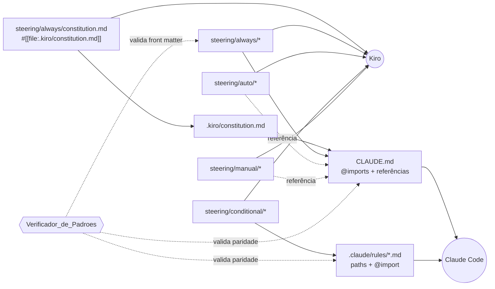
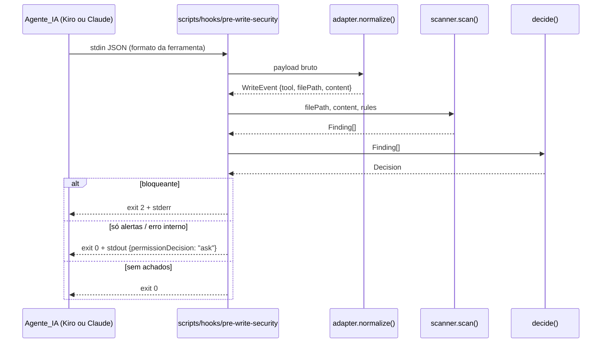

# Design Document — project-standards

**Estimativa_de_Esforco:** 76h (Spec_Simples) · **Requisitos:** [requirements.md](./requirements.md)

## Overview

Este design implementa a Fonte_Canonica_de_Padroes do NuageHub e o ferramental que a mantém viva: Constituicao, Arquivos_Steering, paridade com o Claude Code, hooks de segurança e validação, Verificador_de_Padroes, configurações de lint/format/testes, hooks Git, Pipeline_CI e o esqueleto do Monorepo (App_Web, App_API, um Modulo_IA de exemplo e Pacotes_Compartilhados).

Princípios que guiam as decisões:

1. **Uma fonte, dois leitores.** Regras são escritas só em `.kiro/constitution.md` e `.kiro/steering/**`. `CLAUDE.md` e `.claude/rules/*.md` são arquivos de navegação, compostos apenas de importações e referências, e o Verificador_de_Padroes garante isso.
2. **Lógica em um único lugar.** Os hooks do Kiro e do Claude Code são configurações finas que chamam os mesmos Scripts_de_Hook em `scripts/hooks/`. Um adaptador normaliza o JSON de entrada de cada ferramenta para um evento interno único.
3. **Núcleo puro, borda fina.** Varredura de segurança, classificação de achados, detecção de Stacks_Afetadas e as checagens do verificador são funções puras sobre dados em memória. I/O (stdin, git, sistema de arquivos, processos) fica nos CLIs. Isso viabiliza testes baseados em propriedades.
4. **Site_Legado intocado.** Os arquivos estáticos da raiz ficam fora de todas as verificações por meio de uma lista única de exclusão (`standards.config.json`).

### Pontos em aberto resolvidos

| # | Ponto | Decisão |
|---|-------|---------|
| 1 | Kiro lê steering em subpastas? | Sim, confirmado pelo teste de fumaça (ADR-0002). O Kiro CLI, porém, não aplica `fileMatch` e trata `inclusion: auto` como sempre ativo. Os Steering_Conditional chegam ao Kiro CLI pelo hook `userPromptSubmit` do Agente_de_Projeto_Kiro (ver [Decisão D1](#d1-steering-em-subpastas-adr-0002)). |
| 2 | Constituição fora do steering | `.kiro/steering/always/constitution.md` contém só `#[[file:.kiro/constitution.md]]` (Arquivo_Steering ponteiro). `CLAUDE.md` importa `@.kiro/constitution.md` diretamente. O verificador trata o ponteiro como alias do alvo. |
| 3 | Regras escopadas do Claude Code | `.claude/rules/{nome}.md` com front matter `paths:` (lista de globs) e corpo com uma única importação `@` relativa ao arquivo da regra. O alvo importado é carregado no início da sessão, independentemente de `paths`; limitação aceita (ADR-0002). A forma `@.kiro/...` não resolve dentro de `.claude/rules/`. |
| 4 | Schemas de hooks | Kiro CLI: hooks no Agente_de_Projeto_Kiro (`.kiro/agents/nuagehub.json`), formato objeto `hooks.{preToolUse,stop,userPromptSubmit}[] = {matcher?, command, timeout_ms?}`. Claude: `hooks.PreToolUse[].matcher` + `hooks[].type=command`, e `hooks.Stop`. Payloads reais em `packages/standards/test/fixtures/hooks/`. Adaptador em `packages/standards/src/hooks/adapter.ts`. |
| 5 | Ferramental | pnpm workspaces, ESLint 9 + Prettier, ruff + mypy, uv, Vitest/Jest/pytest, fast-check/Hypothesis, lefthook + commitlint, GitHub Actions, verificador em TypeScript executado direto pelo Node (type stripping). Ver [Decisões de ferramental](#decisões-de-ferramental). |
| 6 | Formato_de_Erro e contratos | JSON Schema canônico em `packages/contracts/schemas/error-format.schema.json`, com tipos TS e modelo Pydantic gerados. Tipos de API gerados por `openapi-typescript` a partir do OpenAPI exportado pelo App_API. |

> As fontes da tabela foram parafraseadas por conformidade com restrições de licenciamento.

## Architecture

### Layout do Repositório

```
/
├── index.html, primeiros-passos.html, plataformas.html, playbook.html   # Site_Legado (intocado)
├── css/styles.css, js/main.js                                          # Site_Legado (intocado)
├── .kiro/
│   ├── constitution.md
│   ├── agents/nuagehub.json                # Agente_de_Projeto_Kiro: hooks + steering condicional
│   ├── settings/cli.json                   # chat.defaultAgent = nuagehub
│   ├── specs/project-standards/{requirements,design,tasks}.md
│   └── steering/{always,auto,conditional,manual}/*.md
├── CLAUDE.md
├── .claude/settings.json
├── .claude/rules/{react,nestjs,python-ai}.md
├── scripts/hooks/pre-write-security        # shim POSIX sh → Node
├── scripts/hooks/post-task-validation      # shim POSIX sh → Node
├── scripts/hooks/conditional-steering      # shim POSIX sh → Node (só Kiro CLI)
├── apps/web/            # React + Vite + Vitest
├── apps/api/            # NestJS + Jest
├── services/ai/example/ # Python + FastAPI + pytest (uv)
├── packages/contracts/  # Formato_de_Erro + tipos OpenAPI (TS) + pacote Python gerado
├── packages/standards/  # Verificador, scanner, adaptador de hooks, detecção de stacks (TS)
├── packages/config/     # tsconfig base compartilhado
├── docs/adr/            # ADRs numerados
├── docs/legacy-migration-backlog.md
├── .github/workflows/ci.yml
├── .github/pull_request_template.md
├── standards.config.json
├── package.json, pnpm-workspace.yaml, pnpm-lock.yaml
├── eslint.config.mjs, .prettierrc.json, .prettierignore
├── ruff.toml, mypy.ini
├── lefthook.yml, commitlint.config.mjs
├── .editorconfig, .gitattributes, .nvmrc, .python-version, .env.example
└── README.md
```

### Fluxo das regras até os agentes



### Fluxo dos hooks



O Hook_Validacao segue o mesmo padrão: shim → `post-task-validation.ts` → `git` lista arquivos alterados → `detectAffectedStacks()` (puro) → executa os comandos por stack → `report()` formata o resultado.

### Decisões de design

#### D1. Steering em subpastas (ADR-0002)

- **Resultado do teste de fumaça:** o Kiro CLI lê `.kiro/steering/**` recursivamente. As subpastas do Req. 2.1 ficam, sem espelhos.
- **Limitação do Kiro CLI:** arquivos `inclusion: fileMatch` e `manual` são excluídos da carga automática, inclusive quando declarados em `resources` de um agente; `inclusion: auto` é tratado como sempre ativo. Hooks `agentSpawn` não rodam em modo não interativo; `userPromptSubmit` roda e seu stdout entra no contexto.
- **Decisão:** o Agente_de_Projeto_Kiro (`.kiro/agents/nuagehub.json`, padrão do workspace via `.kiro/settings/cli.json`) declara o hook `userPromptSubmit` → `scripts/hooks/conditional-steering`. O script imprime cada Steering_Conditional (sem front matter) cujo `fileMatchPattern` case com um arquivo alterado (`git diff --name-only HEAD` + não rastreados) ou cujo diretório base apareça no prompt. O Kiro IDE continua aplicando `fileMatch` nativamente.
- **Alternativa descartada:** espelhos planos gerados. Desnecessários, já que as subpastas funcionam.

#### D2. Constituição via ponteiro

O Kiro carrega só `.kiro/steering/**`. O ponteiro `always/constitution.md` tem front matter `inclusion: always` e corpo `#[[file:.kiro/constitution.md]]`. O Claude Code não interpreta `#[[file:]]`, então `CLAUDE.md` importa `@.kiro/constitution.md`. No modelo do verificador, um Arquivo_Steering cujo corpo é só `#[[file:X]]` é um **ponteiro** com `target = X`. A paridade aceita a importação do alvo ou do ponteiro.

#### D3. CLAUDE.md com gramática restrita (Req. 3.4 e 3.7)

Em vez de comparar texto com a fonte canônica (frágil), o verificador aceita em `CLAUDE.md` apenas linhas que casem com esta gramática:

```
linha := vazia
       | cabeçalho Markdown (#..######) cujo texto esteja na lista NAV_HEADINGS
       | "@" caminho-relativo
       | "- `" caminho "` — " descrição         (referência sob demanda)
       | bloco entre <!-- nav:start --> e <!-- nav:end --> com texto fixo de navegação
```

O texto de navegação fica em `packages/standards/src/claude/nav-text.ts`, que é a fonte do bloco. Qualquer outra linha é tratada como texto de regra e vira violação com arquivo e número da seção. Regras escopadas aceitam só o front matter `paths` e linhas `@caminho`.

#### D4. Scripts sem build (Node com type stripping)

Os Scripts_de_Hook e o verificador rodam como `node packages/standards/src/cli/*.ts`. O Node 24 LTS remove anotações de tipo nativamente, então não há etapa de build nem bundler na inicialização dos hooks, o que importa para os orçamentos de 5 s e 30 s. O `tsconfig` do pacote usa `erasableSyntaxOnly`, `allowImportingTsExtensions` e `verbatimModuleSyntax` para garantir sintaxe compatível. Os shims em `scripts/hooks/` são `sh` POSIX: resolvem a raiz via `git rev-parse --show-toplevel` e fazem `exec node`.

#### D5. Branch protection é configuração, não arquivo

Os Reqs. 15.3 e 17.2 dependem de regras de proteção da branch `main` no GitHub. O design documenta a configuração exigida em `docs/adr/0004-branch-protection.md` e no README: checks obrigatórios `ci / standards`, `ci / web`, `ci / api`, `ci / ai`, `ci / coverage`; PR obrigatório; sem push direto. Aplicar isso no GitHub é ação manual de quem administra o repositório.

### Decisões de ferramental

| Área | Escolha | Justificativa |
|------|---------|---------------|
| Node.js | 24 LTS (`.nvmrc`) | LTS ativo; type stripping nativo (D4). |
| Python | 3.13 (`.python-version`) | Estável com suporte ativo; compatível com FastAPI, Hypothesis, mypy e ruff. |
| Gerenciador JS | pnpm com workspaces e um `pnpm-lock.yaml` na raiz; `packageManager` fixado em `package.json` | Rápido, estrito com dependências fantasmas, `--filter` nativo para stacks afetadas. |
| Python deps | uv, com `pyproject.toml` e `uv.lock` por Modulo_IA | Lockfile reprodutível, rápido, gerencia a versão do Python. |
| Lint/format TS | ESLint 9 (flat config) + typescript-eslint + eslint-plugin-react-hooks + eslint-plugin-jsx-a11y + Prettier | O Biome não cobre jsx-a11y nem regras type-aware no mesmo nível, e o Req. 9.9 depende de checagens a11y automáticas. Config única na raiz (Req. 12.4). |
| Lint/format Python | ruff (lint + format, regras `E,F,I,N,UP,B,S,ANN`) em `ruff.toml` na raiz; mypy `strict` em `mypy.ini` na raiz | O ruff resolve o `ruff.toml` ancestral quando o `pyproject.toml` do módulo não tem `[tool.ruff]`. O mypy recebe `--config-file` apontando para a raiz. |
| Testes | Vitest (web, `packages/*`), Jest (api, padrão do NestJS), pytest + pytest-cov (IA) | Exigência do Req. 14.1. |
| PBT | fast-check (TS), Hypothesis (Python) | Bibliotecas maduras; integram com Vitest/Jest/pytest. |
| Hooks Git | lefthook + @commitlint/cli + @commitlint/config-conventional | O lefthook roda comandos JS e Python sobre arquivos staged sem lint-staged, com config única `lefthook.yml`. |
| CI | GitHub Actions | O remoto já é GitHub (`github.com/joaovitorjvc/Onboarding`). |
| Cobertura de diff | Relatórios Cobertura XML (Vitest v8, Jest, pytest-cov) + `diff-cover --fail-under=80` contra `origin/main` | Uma ferramenta para todas as linguagens mede só as linhas novas ou alteradas (Req. 14.5). |
| OpenAPI → TS | `@nestjs/swagger` (geração) + `openapi-typescript` (tipos) + `openapi-fetch` (cliente tipado) | Tipos gerados sem runtime pesado; o cliente aceita interceptação de erros para o Req. 13.5. |
| API do Modulo_IA | FastAPI + Pydantic v2 | OpenAPI nativo (Req. 11.4). |
| Dev web | Vite | Padrão atual para React + Vitest. |

Todas as dependências entram com versão exata (`save-exact=true` em `.npmrc`; `==` via `uv add`), conforme o Req. 7.7. As versões concretas são resolvidas na implementação e registradas no lockfile.

## Components and Interfaces

### 1. Constituição e steering

**`.kiro/constitution.md`**: cabeçalho `Última alteração: AAAA-MM-DD`. Seções obrigatórias, que o verificador confere por título `##`: `Idioma`, `Segurança`, `Estrutura do Monorepo`, `Testes`, `Contratos entre aplicações`, `Git`, `Fluxo de Specs`. A seção `Fluxo de Specs` descreve o fluxo requisitos → design → tarefas → implementação, os limites de 80 h, o formato de `tasks.md` e a revisão por documento (Req. 6.15 e 6.16). Assim, um agente sem suporte nativo a Specs executa o fluxo lendo só Markdown. A seção `Contratos` documenta o Formato_de_Erro (Req. 13.2).

**Arquivos_Steering iniciais:**

| Caminho | Front matter | Conteúdo |
|---------|--------------|----------|
| `always/constitution.md` | `inclusion: always` | ponteiro `#[[file:.kiro/constitution.md]]` |
| `always/agent-protocol.md` | `inclusion: always` | Req. 7 (Spec antes de código, dependências, idioma, segredos, commits) |
| `always/repository-structure.md` | `inclusion: always` | Req. 8, exclusões do Site_Legado |
| `always/code-style.md` | `inclusion: always` | Req. 12 |
| `auto/spec-workflow.md` | `inclusion: auto`, `name: spec-workflow`, `description` | detalhes do Req. 6 (épicos, Sub_Funcionalidades, EARS) |
| `auto/testing.md` | `inclusion: auto`, `name: testing-standards`, `description` | Req. 14, PBT |
| `auto/api-contracts.md` | `inclusion: auto`, `name: api-contracts`, `description` | Req. 13, Formato_de_Erro |
| `auto/git-workflow.md` | `inclusion: auto`, `name: git-workflow`, `description` | Req. 15 |
| `conditional/react.md` | `inclusion: fileMatch`, `fileMatchPattern: "apps/web/**"` | Req. 9 |
| `conditional/nestjs.md` | `inclusion: fileMatch`, `fileMatchPattern: "apps/api/**"` | Req. 10 |
| `conditional/python-ai.md` | `inclusion: fileMatch`, `fileMatchPattern: "services/ai/**"` | Req. 11 |
| `manual/adr.md` | `inclusion: manual` | template e processo de ADR |
| `manual/security-review.md` | `inclusion: manual` | revisão OWASP aprofundada |

Os nomes de `auto` não podem coincidir com nomes de skills (limitação conhecida do Kiro). Por isso, cada `name` usa um sufixo descritivo.

Cada arquivo começa, após o front matter, com `> Última alteração: AAAA-MM-DD` (Req. 1.5).

### 2. Paridade com o Claude Code

**`CLAUDE.md`** (exemplo do formato aceito pela gramática D3):

```markdown
<!-- nav:start -->
Este arquivo só navega. As regras ficam em .kiro/. Em conflito, vale a Constituição.
<!-- nav:end -->

# Regras sempre ativas
@.kiro/constitution.md
@.kiro/steering/always/agent-protocol.md
@.kiro/steering/always/repository-structure.md
@.kiro/steering/always/code-style.md

# Leitura sob demanda
- `.kiro/steering/auto/spec-workflow.md` — ao criar ou alterar Specs
- `.kiro/steering/auto/testing.md` — ao escrever ou revisar testes
- `.kiro/steering/auto/api-contracts.md` — ao alterar DTOs, OpenAPI ou erros
- `.kiro/steering/auto/git-workflow.md` — ao preparar commits, branches ou PRs
- `.kiro/steering/manual/adr.md` — ao registrar decisão de arquitetura
- `.kiro/steering/manual/security-review.md` — quando pedirem revisão de segurança
```

**`.claude/rules/react.md`:**

```markdown
---
paths:
  - "apps/web/**"
---
@../../.kiro/steering/conditional/react.md
```

A importação `@` é resolvida relativa ao arquivo que a contém (confirmado no teste de fumaça; a forma `@.kiro/...` não resolve em `.claude/rules/`). Em `CLAUDE.md`, na raiz, as duas formas coincidem. O verificador normaliza os caminhos a partir da raiz e, em `.claude/rules/`, exige a forma relativa.

### 3. Hooks

**`.kiro/agents/nuagehub.json`** (Agente_de_Projeto_Kiro; os comandos rodam com `cwd` na raiz do workspace):

```json
{
  "name": "nuagehub",
  "description": "Agente de projeto do NuageHub: hooks de segurança, validação e steering condicional",
  "tools": ["*"],
  "allowedTools": ["read", "grep", "glob", "code"],
  "hooks": {
    "userPromptSubmit": [{ "command": "scripts/hooks/conditional-steering --source kiro", "timeout_ms": 5000, "max_output_size": 65536 }],
    "preToolUse": [{ "matcher": "write", "command": "scripts/hooks/pre-write-security --source kiro", "timeout_ms": 6000 }],
    "stop": [{ "command": "scripts/hooks/post-task-validation --source kiro", "timeout_ms": 600000 }]
  }
}
```

**`.kiro/settings/cli.json`:** `{ "chat.defaultAgent": "nuagehub" }`.

O `conditional-steering` é exclusivo do Kiro CLI e fica fora da paridade de Scripts_de_Hook (Req. 5.10), pois o Claude Code entrega os Steering_Conditional por `.claude/rules/`.

**`.claude/settings.json`:**

```json
{
  "hooks": {
    "PreToolUse": [
      {
        "matcher": "Write|Edit|MultiEdit",
        "hooks": [{ "type": "command", "command": "\"$CLAUDE_PROJECT_DIR\"/scripts/hooks/pre-write-security --source claude" }]
      }
    ],
    "Stop": [
      {
        "hooks": [{ "type": "command", "command": "\"$CLAUDE_PROJECT_DIR\"/scripts/hooks/post-task-validation --source claude" }]
      }
    ]
  }
}
```

**Adaptador (`packages/standards/src/hooks/adapter.ts`):**

```ts
export type HookSource = 'kiro' | 'claude' | 'cli';

export interface WriteEvent {
  source: HookSource;
  toolName: string;
  filePath: string;          // relativo à raiz, com separador "/"
  content: string;           // conteúdo final do arquivo após a escrita
}

export interface StopEvent {
  source: HookSource;
  /** Claude: stop_hook_active; evita laço infinito de reexecução */
  reentrant: boolean;
}

export function normalizeWrite(raw: unknown, source: HookSource, readFile: (p: string) => string | null): WriteEvent;
export function normalizeStop(raw: unknown, source: HookSource): StopEvent;
```

Regras de normalização (validadas com os payloads reais da tarefa 1.3):

- Nome da ferramenta: `tool_name` ou `toolName`.
- Entrada: `tool_input`, `toolInput`, `input` ou `arguments`.
- Caminho: `file_path` (Claude, absoluto), `path` (Kiro, relativo ao `cwd`), `targetFile` ou `filePath`; convertido para relativo à raiz do Repositório usando `cwd` do payload.
- Conteúdo:
  - Escrita completa: Claude `Write` (`content`); Kiro `write` com `command: "create"` (`content`).
  - Edição: Claude `Edit` (`old_string`/`new_string`, `replace_all`); Kiro `command: "strReplace"` (`oldStr`/`newStr`, `replaceAll`). Aplica a substituição ao conteúdo atual em disco.
  - `MultiEdit` (`edits[]`): aplica as substituições em sequência (compatibilidade; ausente no Claude Code 2.1.x).
  - Inserção/append: Kiro `command: "insert"` com `content` e `insertLine` opcional (0-based). Sem `insertLine`, concatena ao fim, inserindo `\n` se o arquivo não terminar com quebra. No Claude, append chega como `Edit` comum.
  - Se o arquivo não existir ou `old` não for encontrado: varre só o trecho novo. A edição falharia de qualquer forma.
- Payload irreconhecível: lança `AdapterError`, que vira `ask` (Req. 4.8).

O esquema exato do stdin do Kiro não está documentado publicamente. Por isso o adaptador aceita aliases e tem testes de contrato com payloads capturados nos dois agentes durante a tarefa 1.

**Scanner (`packages/standards/src/security/`):**

```ts
export type BlockingCategory =
  | 'hardcoded-secret' | 'sql-injection' | 'command-injection' | 'dynamic-eval' | 'unsafe-html';
export type WarningCategory =
  | 'insecure-deserialization' | 'tls-verification-disabled' | 'permissive-cors' | 'weak-crypto' | 'file-too-large';
export type Category = BlockingCategory | WarningCategory;

export interface Rule {
  id: string;
  category: Category;
  languages: ReadonlyArray<'ts' | 'js' | 'py' | 'any'>;
  pattern: RegExp;           // sem backtracking catastrófico; testado contra entrada de 1 MB
  suggestion: string;        // correção sugerida, em pt-BR
}

export interface Finding {
  filePath: string;
  line: number;              // 1-based
  category: Category;
  severity: 'blocking' | 'warning';
  ruleId: string;
  suggestion: string;
}

export function scan(filePath: string, content: string, rules?: readonly Rule[]): Finding[];
export function decide(findings: readonly Finding[]): Decision;

export type Decision =
  | { kind: 'allow' }
  | { kind: 'block'; stderr: string }
  | { kind: 'ask'; reason: string };
```

Detecção por categoria (exemplos, não exaustivos):

| Categoria | Sinais |
|-----------|--------|
| `hardcoded-secret` | prefixos conhecidos (`AKIA[0-9A-Z]{16}`, `ghp_`, `sk-`, `xox[bp]-`, `-----BEGIN .*PRIVATE KEY-----`); atribuição de literal ≥ 16 caracteres com alta entropia a identificador `/(secret|token|password|api[_-]?key)/i`. Arquivos `.env.example` e valores vazios/placeholder (`changeme`, `<...>`) são ignorados. |
| `sql-injection` | template literal ou concatenação com interpolação dentro de string que começa com `SELECT|INSERT|UPDATE|DELETE`; `f"SELECT ... {x}"`; `.query(\`...${` / `.execute(f"...`. |
| `command-injection` | `exec(`/`execSync(` com interpolação; `child_process` com `shell: true` e entrada interpolada; `subprocess.*(..., shell=True)`; `os.system(` com f-string ou concatenação. |
| `dynamic-eval` | `eval(` ou `new Function(` com argumento não literal; Python `eval(`/`exec(` com argumento não literal. |
| `unsafe-html` | `dangerouslySetInnerHTML={{ __html: X }}` em que X não é chamada de `sanitizeHtml(`/`DOMPurify.sanitize(`. |
| alertas | `pickle.loads`, `yaml.load(` sem `SafeLoader`; `rejectUnauthorized: false`, `NODE_TLS_REJECT_UNAUTHORIZED`, `verify=False`; `origin: '*'`/`allow_origins=["*"]`; `createHash('md5'|'sha1')`, `hashlib.md5`. |

Supressão (Req. 4.10): `// security-ignore: <categoria> -- <justificativa>` ou `# security-ignore: ...` na mesma linha ou na linha anterior. Sem justificativa não vazia, a supressão é inválida e gera um Achado_de_Alerta `invalid-suppression`. A supressão vale só para a categoria citada.

Limites: arquivos acima de 1 MB não são varridos e geram o alerta `file-too-large` (→ `ask`). Arquivos binários (byte NUL nos primeiros 8 KB) recebem `allow`. Arquivos do Site_Legado **não** são isentos do scanner, porque segurança vale para qualquer escrita. A isenção do Req. 18.5 cobre só as verificações de stack.

Saídas do CLI `pre-write-security`:

- `allow` → exit 0, sem saída.
- `block` → exit 2; stderr com uma linha por achado no formato `{arquivo}:{linha} [{categoria}] {sugestão}`.
- `ask`, `--source claude` → exit 0; stdout `{"hookSpecificOutput":{"hookEventName":"PreToolUse","permissionDecision":"ask","permissionDecisionReason":"..."}}`.
- `ask`, `--source kiro` → exit 2; stderr começa com `CONFIRMAÇÃO NECESSÁRIA:` e lista os achados, instruindo o agente a pedir confirmação ao usuário e, se aprovado, repetir a escrita com `security-ignore: <categoria> -- <justificativa>`. O Kiro CLI não tem decisão `ask`, e exit 0 permitiria a escrita sem aviso.
- Modo CI (`--files a b c`): lê do disco. Exit 1 se houver bloqueante; alertas viram anotações `::warning` sem falhar o job.

**Validação pós-tarefa (`packages/standards/src/validation/`):**

```ts
export type StackId = 'web' | 'api' | `ai:${string}` | 'packages';

export interface StackCommands { lint: string[]; typecheck: string[]; test: string[]; cwd: string }

export function detectAffectedStacks(changedFiles: readonly string[], config: StandardsConfig): StackId[];
export function commandsFor(stack: StackId): StackCommands;
export function report(results: readonly CheckResult[]): { exitCode: 0 | 2; message: string };
```

Regras de `detectAffectedStacks`:

- Caminhos que casam com `config.legacyPaths` são descartados (Req. 18.5).
- `apps/web/**` → `web`; `apps/api/**` → `api`; `services/ai/{m}/**` → `ai:{m}`.
- `packages/**` → `packages`, que expande para as stacks dependentes via `pnpm --filter ...^{pkg}`. Na prática, `packages/contracts` afeta `web` e `api`.
- Os demais caminhos (docs, `.kiro`) não afetam stacks.
- Resultado ordenado e sem duplicatas.

Comandos por stack:

| Stack | lint | typecheck | test |
|-------|------|-----------|------|
| web | `pnpm --filter @nuagehub/web lint` | `... typecheck` (`tsc --noEmit`) | `... test` (`vitest run`) |
| api | `pnpm --filter @nuagehub/api lint` | `... typecheck` | `... test` (`jest --ci`) |
| ai:{m} | `uv run ruff check . && uv run ruff format --check .` | `uv run mypy --config-file ../../../mypy.ini src` | `uv run pytest` |

Arquivos alterados vêm de `git diff --name-only HEAD` mais `git ls-files --others --exclude-standard`, ou seja, tudo o que ainda não foi commitado. O mesmo método serve para os dois agentes, o que dispensa depender do stdin do `stop`.

Falhas: exit 2 com relatório em stderr (`[stack] verificação: falhou` mais as últimas 40 linhas da saída). No Claude Code, exit 2 em `Stop` devolve a mensagem ao agente; no Kiro CLI, o stderr é mostrado ao usuário como aviso. Com `stop_hook_active=true`, o hook só reporta, com exit 0, para não entrar em laço. Sem stacks afetadas: exit 0 imediato (Req. 5.9).

### 4. Verificador_de_Padroes

CLI: `pnpm standards:check` → `node packages/standards/src/cli/check-standards.ts`.

```ts
export interface Violation { file: string; requirement: string; message: string }  // requirement: "2.6"
export interface RepoSnapshot {
  files: ReadonlyMap<string, string>;   // caminho relativo → conteúdo (só arquivos relevantes)
  config: StandardsConfig;
}
export type Check = (snap: RepoSnapshot) => Violation[];
export function runChecks(snap: RepoSnapshot, checks: readonly Check[]): Violation[];
```

O snapshot é carregado uma vez, a partir de `git ls-files` mais os não rastreados (sem os ignorados), filtrando `.kiro/**`, `.claude/**`, `CLAUDE.md`, `docs/adr/**`, `apps/*/README.md`, `services/ai/*/README.md`, `services/ai/*/{pyproject.toml,uv.lock}` e `.github/**`. Todas as checagens são puras sobre o snapshot, o que mantém o tempo bem abaixo de 30 s (Req. 17.6).

| Checagem | Requisitos |
|----------|-----------|
| `constitutionCheck`: existe exatamente uma, tem as seções obrigatórias e a data no cabeçalho | 1.1, 1.2, 1.5 |
| `steeringHeaderCheck`: data no cabeçalho de cada steering | 1.5 |
| `steeringLayoutCheck`: subpasta ↔ `inclusion`, campos obrigatórios por modo, arquivos fora das subpastas | 2.1–2.7 |
| `steeringScopeCheck`: `react`/`nestjs`/`python-ai` existem em `conditional/` com glob dentro de `apps/web`, `apps/api`, `services/ai` | 2.8 |
| `claudeParityCheck`: conjunto referenciado = conjunto existente (com aliases de ponteiro); globs iguais; gramática D3 | 3.1–3.7 |
| `hookParityCheck`: conjunto de Scripts_de_Hook referenciados no Agente_de_Projeto_Kiro (exceto `conditional-steering`) = no Claude; triggers e matchers esperados | 4.1–4.3, 5.1–5.3, 5.10 |
| `specStructureCheck`: kebab-case, estimativa no cabeçalho, arquivos conforme o formato | 6.1–6.4, 6.11 |
| `epicLinkCheck`: Sub_Funcionalidades linkam os documentos do épico | 6.7 |
| `tasksGraphCheck`: formato de cada tarefa, referências existentes, ausência de ciclos | 6.13, 6.14 |
| `monorepoLayoutCheck`: diretórios obrigatórios, lockfile único, `pyproject.toml` + `uv.lock` por módulo, README por app | 8.1–8.5, 8.7 |
| `adrOnConstitutionChangeCheck` (só em CI, recebe a lista do diff): se `constitution.md` mudou, exige um ADR novo em `docs/adr/` | 1.6 |

Saída: uma linha por violação, `{arquivo} (Req. {x.y}): {mensagem}`, ordenada por arquivo e requisito. Exit 1 se houver violação, 0 caso contrário.

### 5. Scripts padronizados da raiz

`package.json` da raiz:

```json
{
  "scripts": {
    "dev": "node packages/standards/src/cli/run.ts dev",
    "build": "node packages/standards/src/cli/run.ts build",
    "lint": "node packages/standards/src/cli/run.ts lint",
    "typecheck": "node packages/standards/src/cli/run.ts typecheck",
    "test": "node packages/standards/src/cli/run.ts test",
    "standards:check": "node packages/standards/src/cli/check-standards.ts",
    "security:scan": "scripts/hooks/pre-write-security --source cli --files"
  }
}
```

`run.ts <task> [--affected[=base]]` roda a tarefa em todas as stacks, ou só nas afetadas em relação a `base` (padrão `origin/main`), reaproveitando `detectAffectedStacks`. Para JS usa `pnpm -r --filter`, e para cada Modulo_IA usa `uv run`. `dev` sobe web e api em paralelo.

### 6. Esqueletos

- **App_Web:** Vite + React + TS strict. Estrutura `src/app/App.tsx`, `src/features/home/HomePage.tsx`, `src/components/`, `src/theme/tokens.ts` (Tokens_de_Design copiados de `:root` do `css/styles.css`, como `primary: '#4f46e5'`, `bgMain: '#020617'` e `fontFamily: "'Inter', ..."`), `src/api/http-client.ts`, que contém `normalizeError`. Teste: `HomePage.test.tsx` (renderização e a11y com `vitest-axe`) e `http-client.test.ts`.
- **App_API:** NestJS com prefixo global `api/v1`, `ValidationPipe({ whitelist: true, forbidNonWhitelisted: true, transform: true })`, `ErrorFormatFilter` global e `AuthGuard` global com decorator `@Public()`. Módulo `health/` com `health.controller.ts` e `GET /api/v1/health` marcado `@Public()` (Req. 8.8 e 10.12). Config validada com zod em `config/env.ts`. Swagger em `/api/docs`. O `AuthGuard` do esqueleto nega tudo que não for `@Public()`: o mecanismo real de autenticação fica para uma Spec futura. Nenhum endpoint fica exposto sem proteção.
- **Modulo_IA `services/ai/example`:** layout `src/example/`, FastAPI com `GET /health`, `provider_client.py` com timeout configurável (`AI_PROVIDER_TIMEOUT_SECONDS`), log estruturado (duração, resultado, sem segredos) e mapeamento de falha/timeout para o Formato_de_Erro (Req. 11.7 e 11.8). Testes em `tests/test_*.py`.

### 7. Hooks Git e CI

**`lefthook.yml`:**

- `pre-commit`: `prettier --check` e `eslint` nos arquivos staged `*.{ts,tsx,js,mjs,json,md,css}`; `ruff format --check` e `ruff check` nos `*.py`. Todos excluem os caminhos do Site_Legado.
- `commit-msg`: `commitlint --edit {1}`. Em caso de erro, mostra `tipo(escopo): descrição`.

O commitlint usa `config-conventional` mais `scope-enum` (`web`, `api`, `ai`, `contracts`, `standards`, `config`, `ci`, `docs`, `deps`) e `scope-empty: never`. Os nomes de branch (Req. 15.2) são validados em CI pelo job `standards`, com o regex `^(feat|fix|docs|chore|refactor|test|ci|perf|build)/[a-z0-9-]+$`.

**`.github/workflows/ci.yml`** (gatilhos `push` e `pull_request`):

| Job | Passos |
|-----|--------|
| `standards` | `pnpm standards:check`; `commitlint --from base --to head`; validação do nome da branch; `security:scan` nos arquivos alterados; regeneração de contratos + `git diff --exit-code packages/contracts` (Req. 13.3) |
| `web`, `api` | `lint`, `typecheck`, `test --coverage` (cobertura em Cobertura XML) |
| `ai` | matriz por módulo: `uv sync --locked`, ruff, mypy, `pytest --cov --cov-report=xml` |
| `coverage` | depende de web/api/ai; baixa os relatórios e roda `diff-cover *.xml --compare-branch=origin/main --fail-under=80` |

### 8. Contratos (`packages/contracts`)

```
packages/contracts/
├── schemas/error-format.schema.json      # definição única do Formato_de_Erro
├── openapi/api.json                      # exportado do App_API (versionado)
├── src/generated/error-format.ts         # json-schema-to-typescript
├── src/generated/api.ts                  # openapi-typescript
├── src/error-format.ts                   # isErrorFormat(), parse/serialize
├── python/nuagehub_contracts/error_format.py  # datamodel-code-generator (Pydantic v2)
└── package.json  (scripts: generate, check)
```

`pnpm --filter @nuagehub/api openapi:export` inicia o `AppModule` com `NestFactory.create(AppModule, { preview: true })`, sem instanciar provedores, gera o documento e grava `openapi/api.json`. Em seguida, `pnpm --filter @nuagehub/contracts generate` gera os tipos. Os Modulos_IA usam `nuagehub-contracts` como dependência de caminho do uv (`{ path = "../../../packages/contracts/python" }`).

## Data Models

### Formato_de_Erro

```json
{
  "$schema": "https://json-schema.org/draft/2020-12/schema",
  "$id": "https://nuagehub.local/schemas/error-format.json",
  "title": "ErrorFormat",
  "type": "object",
  "additionalProperties": false,
  "required": ["code", "message", "correlationId", "status"],
  "properties": {
    "code":          { "type": "string", "pattern": "^[A-Z][A-Z0-9_]{2,63}$" },
    "message":       { "type": "string", "minLength": 1, "maxLength": 500 },
    "correlationId": { "type": "string", "format": "uuid" },
    "status":        { "type": "integer", "minimum": 400, "maximum": 599 },
    "details": {
      "type": "array",
      "items": {
        "type": "object",
        "additionalProperties": false,
        "required": ["field", "issue"],
        "properties": {
          "field": { "type": "string" },
          "issue": { "type": "string" }
        }
      }
    }
  }
}
```

- `status` foi incluído para que o Req. 13.5 (preservar status) não dependa do transporte.
- `message` é em pt-BR e nunca contém stack trace.
- `correlationId` vem do cabeçalho `x-correlation-id` ou é gerado (UUID v4) por middleware no App_API e no Modulo_IA. Em ambos, é propagado para os logs.
- Códigos reservados: `VALIDATION_FAILED` (400), `UNAUTHENTICATED` (401), `NOT_FOUND` (404), `INTERNAL_ERROR` (500), `AI_PROVIDER_ERROR` (502), `AI_PROVIDER_TIMEOUT` (504), `UNEXPECTED_ERROR` (gerado pelo cliente web).

`normalizeError(status: number, payload: unknown, headers): ErrorFormat` no App_Web: se `isErrorFormat(payload)`, retorna o payload. Caso contrário, retorna `{ code: 'UNEXPECTED_ERROR', message: 'Ocorreu um erro inesperado. Tente novamente.', correlationId: headers['x-correlation-id'] ?? randomUUID(), status }`. Se `status` estiver fora de 400–599, usa 500. Exemplo: um 503 com corpo HTML vira o erro genérico com `status: 503`.

### `standards.config.json`

```json
{
  "legacyPaths": ["index.html", "primeiros-passos.html", "plataformas.html", "playbook.html", "css/**", "js/**"],
  "stacks": {
    "web": "apps/web/**",
    "api": "apps/api/**",
    "ai": "services/ai/*/**",
    "packages": "packages/**"
  },
  "specMaxHours": 80,
  "taskMaxHours": 8
}
```

Os mesmos `legacyPaths` alimentam `.prettierignore`, os `ignores` do `eslint.config.mjs` e `lefthook.yml`. Uma checagem do verificador confere que as quatro listas coincidem.

### Modelo de steering (no verificador)

```ts
type InclusionMode = 'always' | 'auto' | 'fileMatch' | 'manual';
type Folder = 'always' | 'auto' | 'conditional' | 'manual' | null;   // null = direto em .kiro/steering/

interface SteeringFile {
  path: string;
  folder: Folder;
  frontMatter: { inclusion?: string; name?: string; description?: string; fileMatchPattern?: string | string[] };
  pointerTarget?: string;     // definido quando o corpo é só #[[file:X]]
  lastModified?: string;      // data extraída do cabeçalho
}

const EXPECTED_MODE: Record<Exclude<Folder, null>, InclusionMode> = {
  always: 'always', auto: 'auto', conditional: 'fileMatch', manual: 'manual',
};
// effectiveMode(f) = f.frontMatter.inclusion ?? 'always'
```

### Modelo de paridade Claude

```ts
interface ClaudeModel {
  imports: string[];                       // @caminho do CLAUDE.md, normalizados a partir da raiz
  onDemandRefs: string[];                  // caminhos da lista "- `x` — ..."
  scopedRules: { path: string; globs: string[]; imports: string[] }[];
  invalidLines: { file: string; line: number; section: string }[];
}
```

Paridade (Req. 3.5): seja `S` o conjunto de Arquivos_Steering, com os ponteiros substituídos por seus alvos. O conjunto `imports ∪ onDemandRefs ∪ ⋃ scopedRules.imports` deve ser igual a `S`. Além disso, always → `imports`, auto/manual → `onDemandRefs` e conditional → `scopedRules`, com os globs iguais como conjunto.

### Modelo de tarefas (`tasks.md`)

Cada Tarefa_Atomica é um item de checklist com identificador numérico de dois níveis, seguido de sub-bullets de metadados. O marcador `*` após a caixa indica tarefa opcional:

```
- [ ] 3.2 Descrição da tarefa
  - detalhe livre (opcional, quantos forem necessários)
  - _Requirements: 4.5, 4.6_
  - _Depends: 3.1_            (ou `_Depends: -_`)
  - _Stack: standards · Est: 3h_
- [ ]* 3.3 Escrever teste de propriedade
  - **Validates: Requirements 4.5**
  - _Depends: 3.2_
  - _Stack: standards · Est: 0.5h_
```

Em tarefas opcionais de teste, `**Validates: Requirements x.y**` vale como `_Requirements_`. Itens de primeiro nível (`- [ ] 3. Título`) são agrupadores ou checkpoints e ficam fora do grafo.

```ts
interface Task { id: string; title: string; done: boolean; optional: boolean; details: string[]; requirements: string[]; dependsOn: string[]; stack: string; hours: number }
function parseTasks(md: string): { tasks: Task[]; errors: Violation[] };
function formatTasks(tasks: Task[]): string;
function findGraphIssues(tasks: Task[]): { missing: [from: string, to: string][]; cycles: string[][] };
```

Um `tasks.md` com tarefa sem requisitos, com `hours > 8` ou com mais de uma Stack_Afetada gera violação do Req. 6.13.

### Modelo de Spec

```ts
interface SpecDir { name: string; files: string[]; estimateHours: number | null; kind: 'simple' | 'epic' | 'subfeature' }
function expectedFiles(spec: SpecDir): string[];   // simple: 3 arquivos; epic: 2 + ≥1 subpasta; sub: 3
```

A estimativa é extraída por regex `^\*\*Estimativa_de_Esforco:\*\*\s*(\d+)h` do documento de requisitos.

## Correctness Properties

*A property is a characteristic or behavior that should hold true across all valid executions of a system-essentially, a formal statement about what the system should do. Properties serve as the bridge between human-readable specifications and machine-verifiable correctness guarantees.*

Antes de escrever as propriedades, critérios redundantes foram consolidados: os Reqs. 2.2–2.7 viraram uma única propriedade de layout; 3.1/3.2/3.3/3.5, uma propriedade de igualdade de conjuntos; 4.3/5.3/5.10, uma de paridade de scripts; 4.6/4.7, a classificação de `decide`; 5.4/18.5, a detecção de stacks; 6.1–6.4/6.11, a estrutura de Specs. Critérios sobre comportamento do agente (1.4, 6.8–6.10, 7.x), conteúdo semântico (1.3, 6.5, 6.6, 6.12) e configuração da plataforma (15.3) não viram propriedades.

### Property 1: Cabeçalhos e seções dos documentos canônicos

*Para qualquer* Constituicao gerada com um subconjunto aleatório das seções obrigatórias e um cabeçalho de data presente, ausente ou malformado, e *para qualquer* Arquivo_Steering com cabeçalho de data variado, as violações reportadas devem ser exatamente as seções ausentes mais uma violação de data para cada documento sem data válida.

**Validates: Requirements 1.2, 1.5**

### Property 2: ADR exigido em mudança da Constituição

*Para qualquer* lista de arquivos alterados em um pull request, `adrOnConstitutionChangeCheck` reporta violação se e somente se `.kiro/constitution.md` estiver na lista e nenhum arquivo novo `docs/adr/NNNN-*.md` estiver nela.

**Validates: Requirements 1.6**

### Property 3: Consistência entre subpasta e front matter do steering

*Para qualquer* conjunto de Arquivos_Steering gerados (pasta ∈ {always, auto, conditional, manual, raiz}, `inclusion` qualquer ou ausente, `name`/`description`/`fileMatchPattern` presentes, vazios ou ausentes), `steeringLayoutCheck` reporta violação para um arquivo se e somente se: ele estiver na raiz de `.kiro/steering/`; ou `effectiveMode` for diferente de `EXPECTED_MODE[pasta]`; ou faltar campo obrigatório do modo. Toda violação de modo deve conter o caminho, o modo esperado e o modo encontrado.

**Validates: Requirements 2.2, 2.3, 2.4, 2.5, 2.6, 2.7**

### Property 4: Igualdade de conjuntos de referência do Claude Code

*Para qualquer* conjunto de Arquivos_Steering (incluindo ponteiros) e *qualquer* `ClaudeModel` gerado, `claudeParityCheck` não reporta violações de referência se e somente se o conjunto referenciado for igual ao conjunto de steering com ponteiros resolvidos, e cada arquivo estiver no canal do seu modo (always → importação, auto/manual → referência sob demanda, conditional → regra escopada). Os arquivos listados como ausentes e excedentes devem ser exatamente as duas diferenças entre os conjuntos.

**Validates: Requirements 3.1, 3.2, 3.3, 3.5**

### Property 5: Paridade de globs

*Para qualquer* par (lista `fileMatchPattern`, lista `paths` da Regra_Escopada_Claude), o verificador reporta divergência se e somente se os conjuntos normalizados de globs forem diferentes, e a mensagem contém os dois globs.

**Validates: Requirements 3.2, 3.6**

### Property 6: CLAUDE.md contém somente navegação

*Para qualquer* `CLAUDE.md` montado a partir de linhas válidas da gramática D3, com linhas arbitrárias de texto inseridas em posições aleatórias, o verificador reporta exatamente as linhas inseridas (arquivo, linha e seção). Sem inserções, não há violação.

**Validates: Requirements 3.4, 3.7**

### Property 7: Normalização de escrita reconstrói o conteúdo final

*Para qualquer* conteúdo de arquivo existente e *qualquer* operação gerada (escrita completa, substituição única, múltiplas substituições ou append), serializada no formato do Kiro ou do Claude Code, `normalizeWrite` retorna o mesmo `filePath` relativo e um `content` igual ao resultado de aplicar a operação ao conteúdo original.

**Validates: Requirements 4.4**

### Property 8: Detecção de Achado_Bloqueante na linha correta

*Para qualquer* conteúdo seguro gerado e *qualquer* trecho bloqueante do catálogo de cada categoria inserido em uma linha aleatória, `scan` retorna um achado daquela categoria com `severity: 'blocking'` naquela linha. `decide` produz `block`, com stderr contendo o arquivo, a linha, a categoria e a sugestão. Chamar `scan` duas vezes com a mesma entrada produz o mesmo resultado.

**Validates: Requirements 4.4, 4.5**

### Property 9: Classificação da decisão

*Para qualquer* lista de achados, `decide` retorna `block` se houver ao menos um achado bloqueante; `ask` (com todos os achados na razão) se houver só alertas; e `allow` se a lista for vazia. *Para qualquer* conteúdo gerado só a partir do corpus de trechos seguros, `scan` retorna lista vazia.

**Validates: Requirements 4.5, 4.6, 4.7**

### Property 10: Payload malformado vira confirmação

*Para qualquer* valor JSON arbitrário que não represente uma escrita reconhecível, o processamento do Hook_Seguranca resulta em decisão `ask` com a mensagem de erro, nunca em `allow` ou em exceção não tratada.

**Validates: Requirements 4.8**

### Property 11: Supressão inline restrita à categoria justificada

*Para qualquer* conteúdo com um achado de categoria C na linha L, adicionar `security-ignore: C -- <justificativa não vazia>` em L ou L−1 remove esse achado sem alterar os demais. Uma supressão de outra categoria, ou com justificativa vazia, mantém o achado e acrescenta o alerta `invalid-suppression` no caso da justificativa vazia.

**Validates: Requirements 4.10**

### Property 12: Detecção de Stacks_Afetadas

*Para qualquer* lista de caminhos alterados, misturando caminhos de stacks, de pacotes, do Site_Legado e outros, `detectAffectedStacks` retorna exatamente o conjunto ordenado e sem duplicatas das stacks dos caminhos que não são legado. O resultado não muda ao permutar ou duplicar a lista, nem ao adicionar ou remover caminhos do Site_Legado. Uma lista só com caminhos legado ou sem stack retorna vazio.

**Validates: Requirements 5.4, 5.9, 18.5**

### Property 13: Relatório da validação

*Para qualquer* lista de `CheckResult`, `report` retorna `exitCode` 2 se e somente se algum resultado falhou. A mensagem contém, para cada falha, a stack, o nome da verificação e no máximo 40 linhas da saída. Para lista vazia, `exitCode` é 0.

**Validates: Requirements 5.8, 5.9**

### Property 14: Paridade de Scripts_de_Hook

*Para quaisquer* configurações geradas de hooks do Kiro e de `.claude/settings.json`, `hookParityCheck` reporta violação se e somente se os conjuntos de Scripts_de_Hook referenciados diferirem, listando exatamente a diferença simétrica.

**Validates: Requirements 4.3, 5.3, 5.10**

### Property 15: Estrutura de Specs conforme a estimativa

*Para qualquer* diretório de Spec gerado (nome arbitrário, estimativa ausente ou entre 1 e 300 h, conjunto arbitrário de arquivos e subpastas), `specStructureCheck` reporta violação se e somente se: o nome não for kebab-case; ou a estimativa estiver ausente; ou os arquivos diferirem de `expectedFiles` para a estimativa (≤ 80 h → simples, > 80 h → épico). A violação lista a Spec, a estimativa e os arquivos ausentes.

**Validates: Requirements 6.1, 6.2, 6.3, 6.4, 6.11**

### Property 16: Round-trip do formato de tarefas

*Para qualquer* lista válida de `Task`, formatar como Markdown e depois `parseTasks` produz uma lista equivalente, sem erros.

**Validates: Requirements 6.13**

### Property 17: Detecção de dependências inválidas e ciclos

*Para qualquer* grafo de tarefas gerado, `findGraphIssues` reporta como `missing` exatamente as arestas cujo destino não existe. Ele reporta pelo menos um ciclo se e somente se o grafo restrito às tarefas existentes não admitir ordenação topológica, e cada ciclo reportado é um ciclo real do grafo (modelo de referência: algoritmo de Kahn).

**Validates: Requirements 6.14**

### Property 18: Mapeamento de exceções da API para o Formato_de_Erro

*Para qualquer* conjunto de erros de validação de DTO, o `ErrorFormatFilter` produz resposta 400 com corpo válido no schema, código `VALIDATION_FAILED` e um `details` por campo. *Para qualquer* exceção não tratada (mensagem e stack aleatórias), produz 500 com corpo válido no schema, código `INTERNAL_ERROR`, sem a stack e sem a mensagem original no corpo.

**Validates: Requirements 10.4, 10.5, 10.6**

### Property 19: Validação de variáveis de ambiente

*Para qualquer* mapa de ambiente gerado a partir de um válido, com remoções ou valores inválidos aleatórios nas variáveis obrigatórias, a validação falha se e somente se alguma obrigatória estiver ausente ou inválida, e a mensagem cita cada variável problemática.

**Validates: Requirements 10.10, 10.11**

### Property 20: Cliente de provedor de IA: falhas tipadas e logs sem segredos

*Para qualquer* segredo gerado e *qualquer* desfecho simulado do provedor (sucesso, exceção, timeout), o cliente retorna o resultado ou um erro válido no Formato_de_Erro (`AI_PROVIDER_ERROR` 502 ou `AI_PROVIDER_TIMEOUT` 504). O registro de log contém duração e resultado e não contém o segredo.

**Validates: Requirements 11.7, 11.8**

### Property 21: Idempotência do formatador

*Para qualquer* arquivo do corpus TypeScript/JSON/Markdown e Python do Repositório (fora do Site_Legado), com perturbações aleatórias de espaçamento e quebras de linha que preservem a semântica, `format(format(x)) == format(x)` com a configuração versionada (Prettier para TS/JSON/MD, `ruff format` para Python).

**Validates: Requirements 12.5**

### Property 22: Round-trip JSON do Formato_de_Erro

*Para qualquer* objeto válido no schema do Formato_de_Erro, `parse(serialize(e))` é profundamente igual a `e`, tanto em TypeScript (`packages/contracts`) quanto em Python (`nuagehub_contracts`).

**Validates: Requirements 13.4**

### Property 23: Normalização de erro no cliente web

*Para qualquer* status HTTP e *qualquer* payload (JSON arbitrário, string, `null`), `normalizeError` retorna um objeto válido no schema. Se o payload já for válido, o retorno é igual a ele. Caso contrário, o código é `UNEXPECTED_ERROR` e o `status` é o recebido, ou 500 se estiver fora de 400–599.

**Validates: Requirements 13.5**

### Property 24: Saída do verificador

*Para qualquer* lista de violações produzida pelas checagens, o CLI encerra com código diferente de zero se e somente se a lista não for vazia. Cada linha de saída contém o caminho e o requisito da violação correspondente, e a ordem da saída independe da ordem de execução das checagens.

**Validates: Requirements 17.5**

## Error Handling

| Situação | Comportamento |
|----------|---------------|
| Hook_Seguranca: payload irreconhecível, falha de leitura, exceção interna | `ask` com a mensagem do erro (Req. 4.8). Nunca `allow` silencioso. |
| Hook_Seguranca: arquivo > 1 MB ou varredura acima de 4 s (watchdog interno) | `ask` com o alerta `file-too-large` ou `scan-timeout`. Mantém o orçamento de 5 s. |
| Hook_Seguranca: binário | `allow`. |
| Hook_Validacao: `git` indisponível ou fora de repositório | exit 2 com a mensagem `não foi possível listar arquivos alterados`. O agente é informado. |
| Hook_Validacao: `uv`/`pnpm` ausente | falha reportada como verificação `setup` da stack, com a instrução de instalação do README. |
| Hook_Validacao: reentrada no `Stop` do Claude (`stop_hook_active`) | só reporta, com exit 0, para evitar laço. |
| Verificador: Front_Matter YAML inválido | violação do requisito do modo, com a linha do erro de parse. Não interrompe as demais checagens. |
| Verificador: exceção em uma checagem | registrada como violação `interno` daquela checagem, com exit 1. As outras checagens continuam. |
| App_API: validação de DTO | 400 + `VALIDATION_FAILED` + `details`. |
| App_API: `HttpException` conhecida | status da exceção + código mapeado. |
| App_API: erro não tratado | 500 + `INTERNAL_ERROR`. Stack só no log estruturado (pino), com `correlationId`. |
| App_API: env inválida | `process.exit(1)` antes do `listen`, com mensagem citando cada variável. |
| Modulo_IA: falha ou timeout do provedor | 502/504 no Formato_de_Erro. O log registra duração e resultado, sem segredos. |
| App_Web: payload de erro fora do formato | `normalizeError` → `UNEXPECTED_ERROR`, preservando o status. |
| `conditional-steering` falha (git ausente etc.) | exit 0 sem saída; o agente segue sem o Steering_Conditional e o erro vai para stderr. |

## Testing Strategy

### Abordagem dupla

- **Testes baseados em propriedades** cobrem a lógica pura: verificador, scanner, adaptador, detecção de stacks, parser de tarefas, contratos, filtro de erros, validação de env e cliente de IA. Bibliotecas: **fast-check** (TS, com Vitest em `packages/*` e `apps/web`, e com Jest em `apps/api`) e **Hypothesis** (Python). Não haverá implementação própria de PBT.
- **Testes de exemplo** cobrem casos concretos e integração: mapeamento `commandsFor`, presença de arquivos de configuração, `GET /api/v1/health` público, rota de teste não pública → 401, tokens iguais aos de `css/styles.css` (9.6), a11y com `vitest-axe` na `HomePage` (9.9), mensagens aceitas e rejeitadas pelo commitlint (15.1, 15.4), regex de branch (15.2), versões exatas em `package.json` (7.7) e localização dos testes (14.6).
- **Testes de contrato dos hooks:** payloads reais capturados do Kiro e do Claude Code na tarefa 1, salvos em `packages/standards/test/fixtures/hooks/`, passam pelo adaptador como testes de exemplo.
- **Smoke/integração:** `pnpm standards:check` no próprio Repositório (sem violações e em menos de 30 s, Req. 17.6); benchmark do scanner com entrada adversarial de 1 MB em menos de 5 s (Req. 4.9); job de CI completo em PR de teste (17.1, 17.2, 13.3, 14.5); teste de fumaça D1 para steering em subpastas e `@` em `.claude/rules`.
- **Preservação do Site_Legado (18.2, 18.3):**
  - Teste que compara o hash SHA-256 dos seis arquivos legado com o baseline do commit `8e043cf`.
  - Checagem manual das quatro páginas no navegador: estilos, ícones Lucide e persistência do checklist em `nuagehub-checklist`.

### Configuração dos testes de propriedade

- No mínimo 100 iterações por propriedade (`fc.assert(..., { numRuns: 100 })`; `@settings(max_examples=100)`).
- Cada propriedade de design é implementada por **um único** teste de propriedade.
- Cada teste traz um comentário de rastreio no formato:
  `// Feature: project-standards, Property 12: Detecção de Stacks_Afetadas`
  (`# Feature: project-standards, Property 20: ...` em Python).
- Geradores ficam em `packages/standards/test/arbitraries/`: caminhos de repositório, Arquivos_Steering, `ClaudeModel`, grafos de tarefas, corpus de trechos seguros e bloqueantes do scanner.
- A Property 21 (idempotência) roda no corpus real do Repositório. Ela verifica a configuração versionada, não o algoritmo do Prettier/ruff.

### Localização e execução

- TS: `*.test.ts` ao lado do código. Python: `tests/test_*.py` (Req. 14.6).
- Tudo roda por `pnpm test` (execução única) e, por stack, pelo Hook_Validacao e pelo CI.
- Cobertura mínima de 80% nas linhas novas ou alteradas, via `diff-cover` (Req. 14.5).
